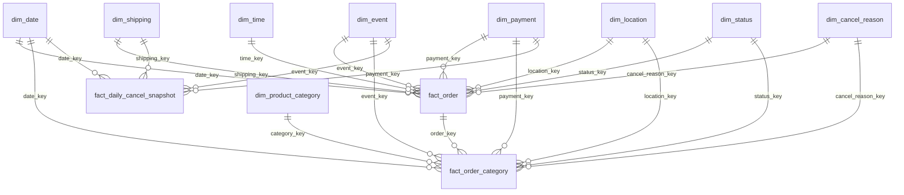

# Cancel-DWH: Data Warehouse Analisis Pembatalan Order Toko Shopee

UAS Kecerdasan Bisnis, Bidang MTI. Adinda Lestari (2410817120015), Teknologi Informasi, ULM.

Dataset: *Indonesia E-Commerce Sales & Shipping 2023-2025* (Kaggle, bakitacos), 24 file bulanan digabung menjadi `data/raw/all_months_clean.csv` (20.848 order, 19 kolom, pemisah `;`, UTF-8 BOM).

## Status pengerjaan

| Komponen | Status |
|---|---|
| Struktur repo, Docker, konfigurasi, `.env.example` | Selesai |
| DDL galaxy schema (9 dimensi, 3 fakta), staging, referensi, audit | Selesai, diuji di PostgreSQL 16 |
| RBAC (role grup, least privilege) | Selesai, diuji |
| Seed tabel referensi, ETL (extract-transform-load), logging | Belum |
| Query validasi Source -> DWH -> Dashboard | Belum |
| Data mart (view KPI), dashboard Streamlit | Belum |
| Backup/restore, uji restore | Belum |
| Evaluasi SUS (min. 20 responden) | Belum |

## Galaxy schema



| Fakta | Grain | Tipe |
|---|---|---|
| `fact_order` | 1 order | transaction |
| `fact_order_category` | 1 order x 1 kategori produk | transaction |
| `fact_daily_cancel_snapshot` | 1 tanggal x 1 metode bayar x 1 layanan kirim | periodic snapshot |

Key `-1` pada setiap dimensi = Unknown. Dimensi yang dipakai bersama (conformed): `dim_date`, `dim_event`, `dim_payment`.

## Layer database

`stg` (mentah) -> `ref` (aturan pemetaan) -> `dw` (galaxy schema) -> `mart` (view KPI) ; `etl` (batch, log, reject = audit trail).

## Cara menjalankan

```bash
cp .env.example .env        # isi password
docker compose up -d        # membuat database + schema + role otomatis
```

Urutan inisialisasi: `sql/01` ... `sql/05`, lalu `sql/90_create_users.sh` membuat user login dari `.env`.

## Hak akses (RBAC)

| User login | Role grup | Akses |
|---|---|---|
| `etl_user` | `role_data_engineer` | tulis `stg`, `dw`, `etl`; baca `ref`, `mart` |
| `steward_user` | `role_data_steward` | ubah `ref`; baca `etl`, `dw`, `mart` |
| `dashboard_user` | `role_data_analyst` | baca `mart` saja |
| `owner_user` | `role_store_owner` | baca `mart` saja |

Password hanya di `.env` (di-`.gitignore`), tidak ada credential di repo.
